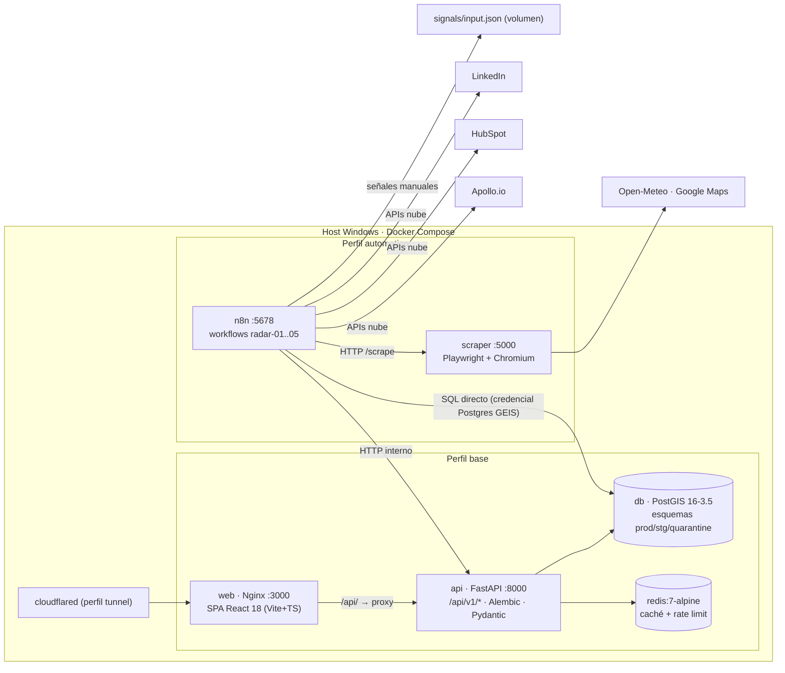
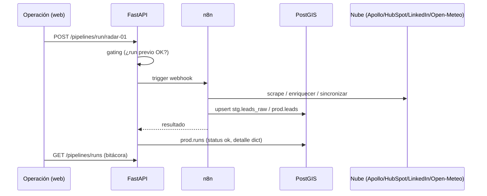

# GEIS — Arquitectura

## Vista general



- **Red interna común**: `geis-net`. **Volúmenes persistentes**: `pgdata` (Postgres), `n8n_data` (credenciales/ejecuciones n8n), `signals/` (bind mount, entrada del paso 03).
- `web` depende de `api` (healthy); `api` de `db` y `redis` (healthy). `n8n`/`scraper` solo arrancan con `--profile automation`; `cloudflared` con `tunnel`.
- **Mismo origen**: el frontend consume rutas relativas `/api/…`; Nginx las proxya a `api:8000` (sin CORS en local).

## Capas

### 1. Capa de datos (PostgreSQL + PostGIS)

- Imagen `postgis/postgis:16-3.5` (upgrade desde 15-3.4; ver [ADR-001](decisions/ADR-001-postgis-16-35.md)).
- Extensiones (`db/init.sql`, corre una sola vez al crear el volumen): `postgis`, `pg_trgm`, `uuid-ossp`.
- Esquemas separados por ciclo de vida:
  - `prod.*` — verdad operativa: `leads`, `runs`, `providers`, `warm_signals`, `linkedin_stats`, `denue_establishments`, `user_investigations`, territorios/reportes/propuestas (GEIS).
  - `stg.*` — landing crudo: `leads_raw` (salida del scrapeo, con flag `procesado`).
  - `quarantine.*` — registros rechazados por validación.
- Las **tablas** las crea **Alembic** (`make migrate`), no `init.sql`.

### 2. Capa de API (FastAPI)

- Entrada `backend/app/main.py`, routers en `backend/app/api/v1/` (16 routers; detalle en [api/rest.md](api/rest.md)).
- Patrones clave:
  - **Paginación por cursor** en `/leads` y `/leads/curados`: `limit` (máx. **100**, `FastAPI Query(le=100)`) + `cursor`/`next_cursor`. No devuelven `total` — contar exige iterar.
  - **Gating por orden** en `POST /pipelines/run/{stage}`: `409` si el paso anterior no terminó OK (el pipeline se lee de `prod.runs`).
  - **Capa de providers**: cada capacidad (`scraper`, `enrichment`, `crm`, `email`, `weather`, `linkedin`, `geocoding`, `routing`) tiene fila en `prod.providers` con `mode` local/cloud/disabled; el backend resuelve la ruta según modo.
  - **Modelo estricto Pydantic**: `RunOut` exige `detalle` como `dict` — arrays o `NULL` en `prod.runs.detalle` provocan `500` (ver [ADR-005](decisions/ADR-005-gobernanza-prod-runs-detalle.md)).
- Montaje en vivo: `./backend` → `/code` (cambios sin rebuild; `docker compose restart api`).

### 3. Capa de orquestación (n8n)

- Versión **2.35.7**, credenciales cifradas con `N8N_ENCRYPTION_KEY` (64 hex) del `.env`.
- 5 workflows en `n8n/workflows/*.json`, importados por ID (Nanoid top-level) vía `n8n import:workflow --separate` (upsert); 3 credenciales inyectadas programáticamente (`n8n import:credentials`): **Postgres GEIS** (`ssl:"disable"`), **Apollo API**, **HubSpot**.
- **Triple trigger** por workflow: webhook desde la API, manual (UI) y CLI (`n8n execute`).
- Acceso a archivos restringido a `/signals` (`N8N_RESTRICT_FILE_ACCESS_TO=/signals`).
- Ver [ADR-002](decisions/ADR-002-endurecimiento-n8n.md) y [ADR-003](decisions/ADR-003-code-nodes-n8n.md).

#### Pipeline Radar (orden 01 → 05)

| Stage | Workflow | Qué hace | Salida |
|---|---|---|---|
| `radar-01` | `01-radar-scrape.json` | Scrapear Google Maps (vía scraper o Apify cloud) | `stg.leads_raw` |
| `radar-02` | `02-dedup-score.json` | Dedup contra `prod.leads`, scoring conductual (+Open-Meteo), línea recomendada, enriquecimiento Apollo (rama cloud), geocodificación → `temp_zona` | `prod.leads` |
| `radar-03` | `03-signal-catcher.json` | Lee `signals/input.json` (nodo Parsear JSON), consolida señales cálidas | `prod.warm_signals`, `prod.leads` |
| `radar-04` | `04-crm-sync.json` | Espeja leads a HubSpot con propiedades custom `biokool_etapa/score/linea` | HubSpot Companies |
| `radar-05` | `05-linkedin-signals.json` | Estadísticas de página LinkedIn (Biokool, org `107784991`) → picos de engagement | `prod.linkedin_stats`, `prod.warm_signals` |

Flujo detallado del paso 03 (post-fix):

```
Leer signals/input.json (Read Binary File)
  → Parsear JSON (extractFromFile · fromJson · binaryProperty "data")   ← evita BOM
  → Parsear señales (Code · runOnceForAllItems · lee $input.first().json.data)
  → Consolidar / Armar warm
  → API backend /signals + /leads
```

### 4. Capa de presentación (React SPA)

- Stack: React 18.3, react-router-dom 6, Vite 5.4, TypeScript 5.5, Tailwind 3.4, Radix UI (shadcn), TanStack Table 8, **ECharts 5.5**, **Leaflet 1.9 + react-leaflet 4.2 + geoman 2.17**, zustand 4, sonner.
- Páginas: `Inicio` (dashboard de KPIs), `Mapa`, `Kpis`, `Leads`, `LeadsRadar`, `Operacion`, `Historial`, `Sistema` (providers/integraciones), `Configuracion` (perfil empresa), `Asistente IA`, `Exportacion`, `Geofencing`, `Reporte`, `Analisis`, `Territorios`.
- Cliente API central: `frontend/src/lib/api.ts` (interfaces TS espejo de los modelos Pydantic, p. ej. `LeadCurado`).
- Mapa: herramientas de dibujo geoman y `ZoomControl` en `topright` (la leyenda "Capas" vive en `topleft`, `z-[500]` — por eso se movieron los controles).

### 5. Capa de scraping (scraper)

- Python 3.11-slim-**bookworm** + Playwright 1.49.0 + Chromium (`playwright install --with-deps chromium` en build; imagen ~2.1 GB).
- Endpoints: `POST /scrape` (Google Maps → leads crudos), `GET /health`.
- Modo `cloud` alternativo: Apify (plan FREE, token validado).

## Flujo de datos end-to-end (camino feliz)



## Áreas críticas y riesgos

| Riesgo | Mitigación |
|---|---|
| `N8N_ENCRYPTION_KEY` cambia → credenciales ilegibles + crash loop | Generarla una vez, jamás rotarla sin re-importar credenciales |
| `prod.runs.detalle` como array/NULL → 500 en `/pipelines/runs` | ADR-005: siempre `dict` (JSONB objeto) |
| BOM en JSON leídos por n8n (`Unexpected token '~'`) | Escribir UTF-8 **sin BOM**; nodo `Parsear JSON` intermedio |
| Code nodes devolviendo arrays crudos → "A 'json' property isn't an object" | ADR-003: return `{ json: {...} }` |
| `limit > 100` en `/leads*` → 422 | ADR-004: el frontend pide ≤100 y pagina por cursor |
| Browser cache con bundle viejo → 404 `/api/runs/activos` | Hard refresh; no es código actual |
| LinkedIn token expira | `expires_at` guardado en provider; re-OAuth manual |

## Antipatrones a evitar

- No escribir en `backend/app` ni `frontend/src` **sin autorización explícita** del owner (regla `AGENTS.md`; ver [conventions.md](conventions.md)).
- No usar booleanos en `ssl` de credenciales Postgres de n8n (Postgres node v2.6 exige string `"disable"`).
- No commitear `.env`, backups SQL ni `signals/input.json`.
